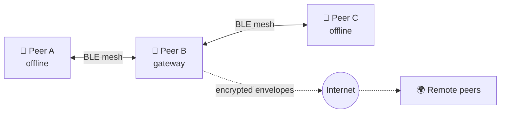

<div align="center">

<picture>
  <source media="(prefers-color-scheme: dark)" srcset="design/brand/hopla-v2/readme-header-dark.svg">
  
</picture>

# Open Mesh Chat Protocol

**An open protocol for private messaging that keeps working when the Internet doesn't.**

[](./LICENSE)
[](./PROTOCOL.md)
[](https://github.com/un-the-et-un-cafe/open-mesh-chat/actions)

[Specification](./PROTOCOL.md) · [Reference app](#reference-app-hopla) · [Build your own client](#build-your-own-client) · [Roadmap](#roadmap) · [Contributing](#contributing)

</div>

---

## About

**OMCP (Open Mesh Chat Protocol)** lets phones talk to each other directly over Bluetooth. Every device relays messages for the others, so a crowd of phones becomes its own network. When any one device has Internet access, it can carry encrypted traffic out for everyone nearby. It never sees what's inside.

OMCP is a **protocol**, not a single app. This repository contains:

- **the open specification**, which is the source of truth for anyone building a compatible client
- **`omcp-core`**, a reference library in Rust
- **Hopla**, the reference app for Android and iOS, which shows the protocol in action

Anyone can build their own app, gateway, bot or desktop client on OMCP. Any app that follows the spec can talk to every other OMCP app.

### Why it matters

- **Outages, protests, disasters, festivals, remote areas:** messages still reach people nearby with no cell network or Wi-Fi.
- **No central server holds your conversations:** there is no company in the middle that could read, sell or lose them.
- **Security that holds up long term:** the encryption is designed to stay safe against future quantum computers, not just today's attacks.

---

## Highlights

| | |
| --- | --- |
| 📡 **Mesh first** | Peer-to-peer over Bluetooth Low Energy, with no Internet needed |
| 🌉 **Every peer can be a gateway** | Online devices relay encrypted envelopes for offline neighbours |
| 🔐 **End-to-end encrypted by default** | Noise handshake, MLS for groups, sealed sender addressing |
| 🛡️ **Post-quantum hybrid** | X25519 + ML-KEM-768 key exchange (suite `OMCP-2026-A`) |
| 📦 **Store and forward** | Messages wait on nearby peers until the recipient shows up |
| 🧩 **Open and extensible** | Versioned wire format, crypto agility and a public extension process |
| 👥 **Communities and live** *(v0.2)* | Channels, roles, and end-to-end encrypted livestreams over Wi-Fi or Internet |

---

## How it works



1. Phones find each other over Bluetooth and set up encrypted sessions.
2. Messages hop from phone to phone until they reach the recipient.
3. If a phone along the way has Internet, it forwards the **still-encrypted** envelope to recipients farther away.
4. When the Internet drops, the local mesh keeps working.

---

## Reference app: Hopla

The Android (12+) and iOS (17+) apps in this project are the **reference implementation** of OMCP. They show what the protocol can do, and they're meant to be a polished app people want to use.

> Hopla is **one** OMCP client, not the only one. Other apps that follow the spec are full members of the network.

Product requirements: [`apps/REQUIREMENTS.md`](./apps/REQUIREMENTS.md). UI design pack: [`design/`](./design/).

---

## Build your own client

You don't need our code or our app to join the network. To build a compatible client:

1. Implement the wire format and crypto suite in [`PROTOCOL.md`](./PROTOCOL.md). The normative pins are in §21.
2. Use `omcp-core` (Rust) if you like, or write your own implementation in any language.
3. Pass the acceptance scenarios in §13.6, and the test vectors as they're published.
4. Advertise your supported features in the `Hello` handshake. Peers negotiate the rest.

Ideas for the community: desktop clients, dedicated gateway nodes (Raspberry Pi), emergency-response tools, bots, and bridges to other open protocols.

---

## Repository layout

```
.
├── PROTOCOL.md          # The OMCP specification (normative)
├── extensions/          # Protocol extensions (e.g. MLS post-quantum)
├── crates/omcp-core/    # Reference Rust library
├── apps/                # Reference Android & iOS apps
├── design/              # Reference UI and brand assets
└── .github/workflows/   # CI
```

---

## Roadmap

| Milestone | Scope | Status |
| --- | --- | --- |
| **M0** | Specification and CI skeleton | ✅ Done |
| **M1** | `omcp-core`: Noise hybrid handshake and envelope framing | 🚧 [In review](https://github.com/un-the-et-un-cafe/open-mesh-chat/pull/1) |
| **M2** | BLE transport and two-device text chat | ⏳ Planned |
| **M3** | MLS groups and chunked file transfer | ⏳ Planned |
| **M4** | Gateway role and optional rendezvous | ⏳ Planned |
| **M5** | Android reference beta | ⏳ Planned |
| **M6** | iOS reference beta | ⏳ Planned |
| **M7** | Independent cryptography review | ⏳ Planned |

**v0.2:** communities, channels, livestreams, stories, polls. **v0.3:** usernames, bots, and an optional Tor transport.

---

## Security

OMCP is a **draft and has not been audited**. Don't rely on it for life-critical communication yet.

Please report vulnerabilities privately through [GitHub Security Advisories](https://github.com/un-the-et-un-cafe/open-mesh-chat/security/advisories/new) rather than public issues. The threat model is in [`PROTOCOL.md` §4](./PROTOCOL.md).

---

## Contributing

Contributions are welcome:

- **Protocol changes:** open a PR against `PROTOCOL.md` with your reasoning, the impact on the wire format, and test vectors.
- **Extensions:** add a proposal under `extensions/` (see §16).
- **Code and design:** open an issue first for anything large.

Please be respectful. This project exists to protect people who may be in vulnerable situations.

---

## Licence

[MIT](./LICENSE) © OMCP contributors
