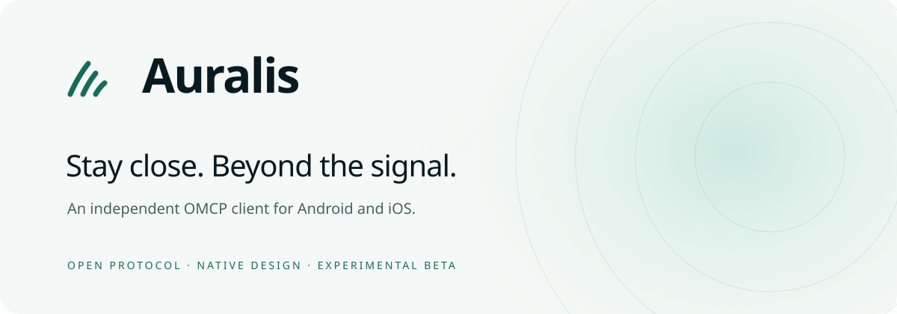

<div align="center">
<picture>
  <source media="(prefers-color-scheme: dark)" srcset="design/brand/auralis/readme-header-dark.svg">
  
</picture>

# Auralis

**An alternative OMCP client. An independent interpretation of how the mesh should feel.**

Android 12+ · iOS 17+ · Kotlin / Compose · SwiftUI · Rust

[Protocol](PROTOCOL.md) · [Compatibility audit](docs/AURALIS_PROTOCOL_AUDIT.md) · [Verification](docs/AURALIS_VERIFICATION.md) · [Releases](docs/AURALIS_RELEASE.md) · [Android](apps/android/README.md) · [iOS](apps/ios/README.md)
</div>

> **Experimental development build.** The underlying protocol is a draft and has not had an independent security audit. Do not rely on this software for emergency, life-critical, or high-risk communications. Native device interoperability must be tested before claiming release readiness.

## A different way to see the mesh

Auralis brings conversations, connectivity, and personal security into one calm, legible experience. Its native application presentation is organized around three spaces:

- **Conversations:** people and messages first, with honest delivery and verification states.
- **Mesh:** understand the connection available now; see what is queued, add a contact, and reach gateway settings without confusing a roadmap promise for a live connection.
- **You:** identity, recovery, backups, storage, and privacy in one place.

Deep ink, luminous mint, warm off-white surfaces, clear hierarchy, and an original three-stroke signal mark form the Auralis visual system. Both platforms remain native rather than wrapping a website.

## Foundation and compatibility

This project derives from [Hopla / open-mesh-chat](https://github.com/un-the-et-un-cafe/open-mesh-chat), baseline commit `233210d5b13f443798428d126266c520999ad387`.

The **app experience is new; the cryptography is not reinvented**. The shared `omcp-core`, `omcp-ffi`, transport adapters, persisted formats, and protocol identifiers remain the compatibility foundation. Attribution and the upstream MIT license are preserved. The original normative `PROTOCOL.md` is unchanged.

Auralis targets compatibility with **the implemented Hopla beta**, not unsupported claims of complete draft-protocol conformance. The audit explains the differences. Shared code and contract tests provide evidence, but do not replace testing two real devices running independently built Hopla and Auralis.

### Implemented upstream capabilities retained

- Recovery-phrase identity and encrypted backup/restore flows.
- QR contact exchange, safety-number verification, and mismatch handling.
- Direct one-to-one BLE chat, offline queue handling, and reconnect logic.
- Chunked encrypted file transfer with size caps and integrity verification.
- Burn-after-read messages and privacy-conscious notification policies.
- Platform storage, backup, notification, and security settings.
- English and French localization, light and dark appearance.

Platform services still need their own configuration and device testing. See each platform README for precise limitations.

### Explicitly not production features

Working Internet gateway transport, MLS group messaging in the app, communities, live streams, calls, and full draft-protocol coverage are not claimed. Settings or preview screens for these do not implement their underlying transport. Bluetooth delivery and background behavior depend on OS permissions, radio conditions, platform restrictions, and nearby peers. No app can prevent someone photographing a screen with another device.

## Build and verify

```sh
cargo fmt --all -- --check
cargo clippy --workspace --all-targets --locked -- -D warnings
cargo test --workspace --locked
```

Android additionally needs a JDK, Android SDK/NDK, Rust Android targets, and `cargo-ndk`. iOS app builds require macOS, Xcode, and XcodeGen. Follow the platform-specific instructions linked above; installing Rust alone does not produce a phone-ready application.

CI is designed to check the core and both native apps. Manual release packaging produces **unsigned / testing artifacts**, not an App Store or Google Play release. Store distribution needs separate signing, ownership, policy review, and explicit approval.

## Repository

```text
PROTOCOL.md                 Unmodified upstream normative draft
crates/omcp-core/            Shared protocol and crypto implementation
crates/omcp-ffi/             Native bridge
crates/omcp-sim/             Protocol simulations
apps/android/               Native Android client
apps/ios/                   Native iOS client and platform-independent tests
design/brand/auralis/        Original Auralis brand assets
docs/AURALIS_PROTOCOL_AUDIT.md  Compatibility boundaries and test plan
docs/AURALIS_RELEASE.md      Quality gates and release procedure
.github/workflows/          Verification and manual packaging
```

## Attribution and security

Copyright and credit for inherited work remain with the OMCP/Hopla contributors under [LICENSE](LICENSE). Auralis is a distinct app identity, not a claim of endorsement by upstream contributors. The name is a working product name, not a trademark-clearance claim.

Do not post secrets, recovery phrases, private messages, or exploit details in public issues. Before using this software in sensitive situations, obtain independent cryptographic review and execute the documented cross-client, device, backup, and failure-recovery tests.
